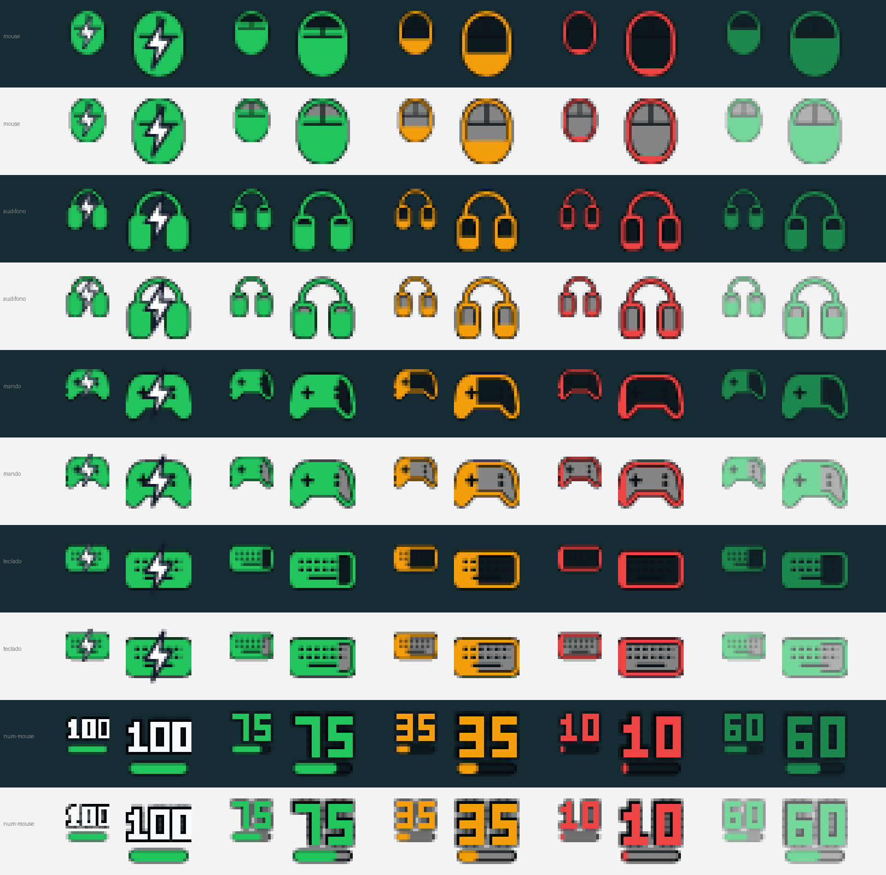

# Batería de periféricos

La batería de tu mouse, audífonos y mandos inalámbricos en la bandeja de Windows, **sin G HUB, iCUE ni la app de cada marca**. Un solo `.exe` de ~1,2 MB, unos 10 MB de RAM y prácticamente 0 % de CPU.



## Descargar

**[⬇ bateria-perifericos.exe](https://github.com/AndersonDavi/bateria-perifericos/releases/latest/download/bateria-perifericos.exe)** (Windows 10/11, 64 bits). No necesita instalación: se abre y queda en la bandeja.

Windows puede mostrar "Windows protegió tu PC" porque el `.exe` no está firmado: **Más información → Ejecutar de todas formas**.

Para que arranque con Windows: clic derecho en el ícono → **Iniciar con Windows**.

## Qué hace

- **Un ícono por dispositivo** con su silueta (mouse, audífonos, mando, teclado) que se llena según la carga: verde > 40 %, ámbar 16–40 %, rojo ≤ 15 %. Rayo mientras carga; atenuado con el último dato si el dispositivo está dormido o apagado. Opción de mostrar el % en números.
- **Hover:** %, estado, tiempo restante estimado y por dónde se leyó (receptor, cable…). Clic izquierdo: actualizar.
- **Avisos de Windows** al bajar de 50, 25, 15, 10, 7 y 5 % (con el tiempo restante), al llegar al 90 % cargando (opcional, para no dejarlo siempre al 100 %) y al terminar de cargar.
- **Tiempo restante por uso real:** cuenta solo el tiempo que el dispositivo está despierto y con batería, ajusta una recta (mínimos cuadrados) desde la última carga y lo traduce a días según tu ritmo de uso de la última semana.
- **Historial y estadísticas** por dispositivo: duración por carga, última carga (de qué % a qué % y cuánto tardó), ciclos y **salud de la batería** (cuánto dura una carga ahora vs. al principio).
- **Gráfico** en el navegador con la curva de batería, las cargas y las descargas.
- **Reacciona al instante** al conectar o desconectar un cable o un receptor.
- **Respaldo** opcional del historial en una carpeta sincronizada (Google Drive, OneDrive…).

## Dispositivos

| Familia | Cómo se lee | Estado |
|---|---|---|
| **Logitech** con receptor LIGHTSPEED / Unifying / Bolt, o por cable | HID++ 2.0 (features 0x1004, 0x1000, 0x1001) | ✅ Probado con G305 X SUPERLIGHT |
| **Corsair HS80 Max Wireless** | Protocolo "Void v2" y, si no responde, "bragi"/Slipstream | ⚠️ Sin probar con el audífono real |
| Corsair Void v2 Wireless, Virtuoso Max, Virtuoso RGB SE/XT | Los mismos protocolos | ⚠️ Según protocolo documentado |
| **Mandos** GameSir, Xbox y otros con protocolo Xbox | Windows.Gaming.Input (% real y carga); si no, XInput (4 niveles aprox.) | ⚠️ Sin probar con GameSir Cyclone 2 |

Si tu dispositivo no aparece o lee mal: clic derecho en el ícono → **Generar diagnóstico**. Se abre `diagnostico.txt` con lo que expone cada receptor y las respuestas crudas (sin números de serie); adjúntalo en un [issue](https://github.com/AndersonDavi/bateria-perifericos/issues).

Las apps del fabricante (iCUE, G HUB, la app de GameSir…) a veces ocupan el dispositivo y bloquean la lectura. Si algo no aparece, ciérralas y prueba de nuevo; el diagnóstico dice cuáles están abiertas.

## Datos

Todo queda en `%LOCALAPPDATA%\BateriaPerifericos\`:

| Archivo | Contenido |
|---|---|
| `historial-<dispositivo>.csv` | Una fila cada vez que cambia el % o el estado: `unix,fecha,porcentaje,estado,via,uso_s` |
| `ajustes.txt` | Opciones del menú |
| `respaldo.txt` | (Opcional) carpeta donde copiar los historiales, por ejemplo `G:\Mi unidad\BateriaPerifericos`. Si el respaldo tiene más historia que el local (PC nueva, reinstalación), se restaura solo. |
| `grafico.html`, `diagnostico.txt` | Se generan al pedirlos desde el menú |

## Compilar

Requiere Rust (toolchain MSVC) y las herramientas de C++ de Visual Studio. Si `link.exe` no está en el PATH, carga antes el entorno de Visual Studio:

```powershell
cmd /c '"C:\Program Files\Microsoft Visual Studio\18\Community\VC\Auxiliary\Build\vcvars64.bat" && cargo build --release'
powershell -ExecutionPolicy Bypass -File .\instalar.ps1    # opcional: -Respaldo "G:\Mi unidad\BateriaPerifericos"
```

Herramientas para desarrollo:

```powershell
target\release\bateria-perifericos.exe --probe -v          # una lectura por consola, con el tráfico crudo
target\release\bateria-perifericos.exe --preview <carpeta> # exporta los SVG de los íconos
target\release\bateria-perifericos.exe --grafico <csv>     # genera el gráfico de un historial
cargo test
```

## Agregar un dispositivo

Cada familia es un módulo en `src/` con una función `read_all(...) -> Vec<Reading>`, llamada desde `device::read_all`:

- `hidpp.rs`: Logitech.
- `corsair.rs`: Corsair (recuerda qué protocolo responde en cada receptor).
- `gamepad.rs`: mandos (Windows.Gaming.Input y XInput).

Un `Reading` lleva `key` (estable: nombra el historial), `name`, `kind` (silueta del ícono), `percent`, `charge`, `link` y `approx`. El resto (íconos, avisos, historial, gráfico, respaldo) funciona igual para cualquier dispositivo. Usa el parámetro `log` para dejar en el diagnóstico los intercambios crudos.

## Créditos

- [HaloBattery](https://github.com/HeyOkay/HaloBattery) (MIT, © 2026 Halo Battery contributors): notas de protocolo de Corsair y de mandos por Windows.Gaming.Input, y el enfoque de estimar el tiempo restante por uso real.
- [HeadsetControl](https://github.com/Sapd/HeadsetControl), [ckb-next](https://github.com/ckb-next/ckb-next) y [OpenLinkHub](https://github.com/jurkovic-nikola/OpenLinkHub): de donde salen los protocolos de Corsair.
- [Solaar](https://github.com/pwr-Solaar/Solaar): curva de voltaje y referencias de HID++.

Licencia [MIT](LICENSE).
